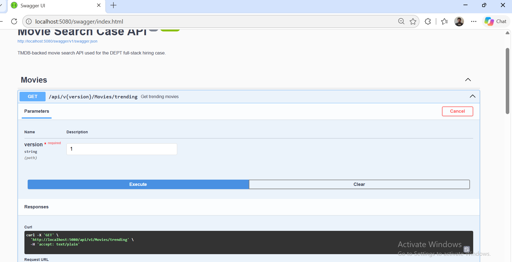
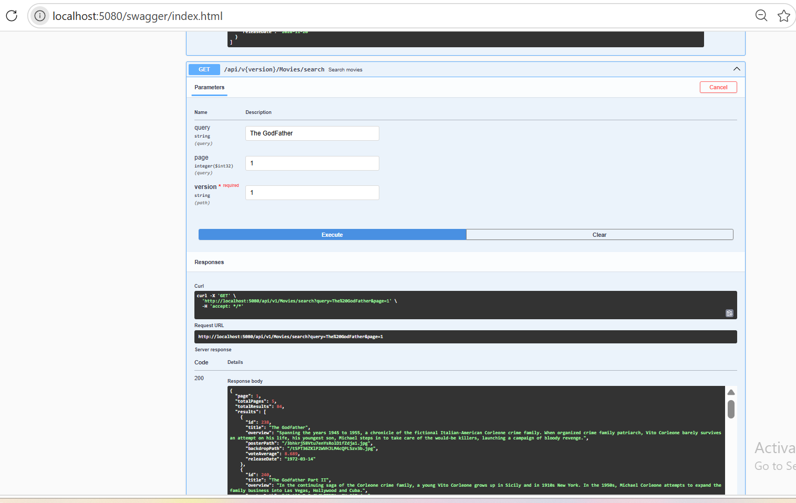
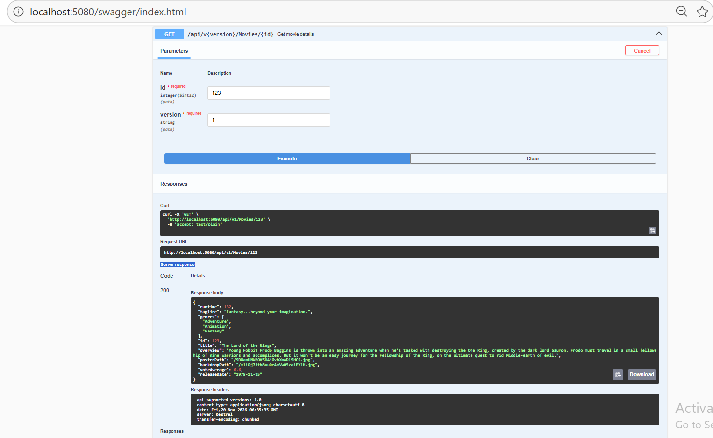
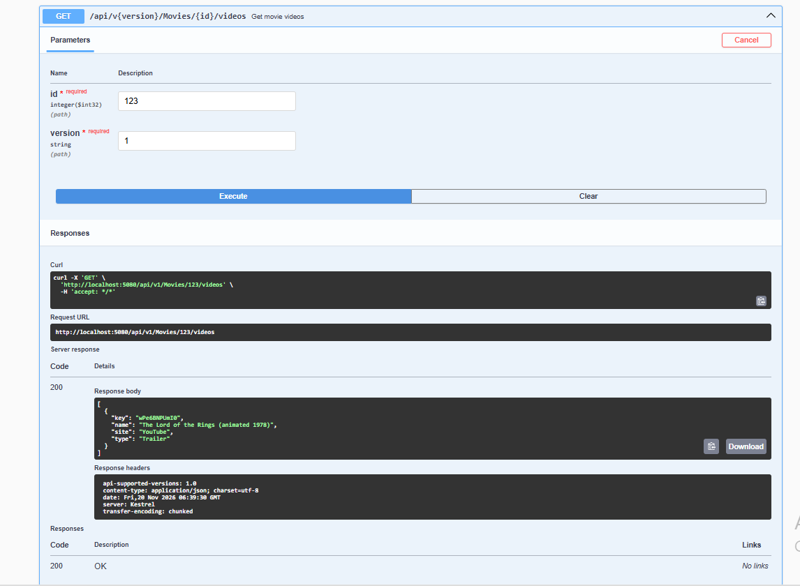
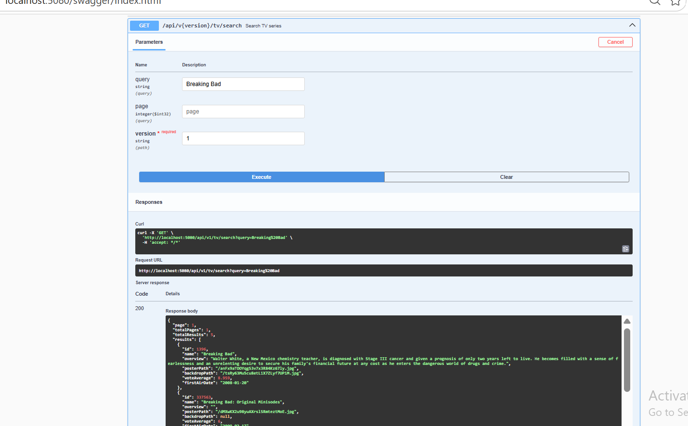
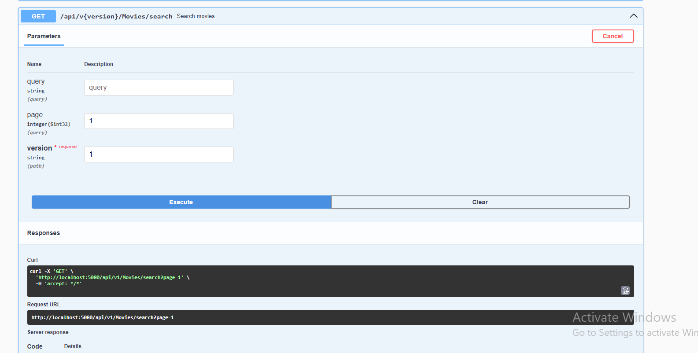
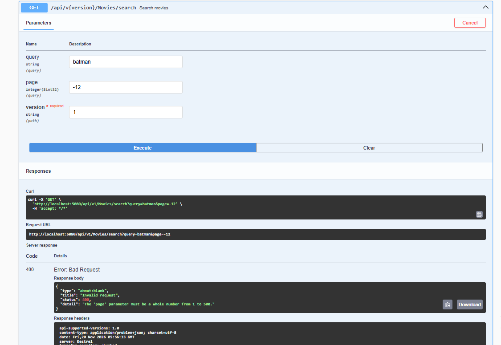

# API Testing and Results

This document records how to run the Movie Search API, exercise it in Swagger or Postman, and interpret the expected results. Screenshot placeholders are included for adding evidence later.

## 1. URLs

| Resource | URL |
|---|---|
| Swagger UI | `http://localhost:5080/swagger` |
| OpenAPI JSON | `http://localhost:5080/swagger/v1/swagger.json` |
| API v1 base URL | `http://localhost:5080/api/v1` |

The API currently implements version 1 only. Version 2 is unsupported and is expected to return 404.

## 2. Start the API

From the repository root, run:

```powershell
dotnet run --project src/MovieSearchCase.WebApi
```

The API needs a valid TMDB API Read Access Token and outbound network access for live TMDB-backed success responses. Configure the token through the ignored development-local settings file, user secrets, or environment configuration. Never include the token in screenshots, shared Postman collections, or source control.

When the app is running, open the Swagger URL above. Swagger is enabled in Development. Expand an endpoint, choose **Try it out**, enter path or query values, then select **Execute**.

## 3. Endpoint requests

All current API operations use GET requests. Inputs are in the URL; these endpoints do not accept a JSON request body.

| Purpose | Method and URL | Expected success |
|---|---|---|
| Trending movies | `GET http://localhost:5080/api/v1/movies/trending` | `200 OK`, JSON array of Movie objects. |
| Search movies | `GET http://localhost:5080/api/v1/movies/search?query=batman&page=1` | `200 OK`, paging envelope with `page`, `totalPages`, `totalResults`, `results`. |
| Movie details | `GET http://localhost:5080/api/v1/movies/268` | `200 OK`, Movie fields plus `runtime`, `tagline`, `genres`. |
| Movie videos | `GET http://localhost:5080/api/v1/movies/268/videos` | `200 OK`, JSON array of videos; can be empty. |
| TV series search | `GET http://localhost:5080/api/v1/tv/search?query=breaking%20bad&page=1` | `200 OK`, paging envelope with TV fields such as `name` and `firstAirDate`. |

Live result data and pagination counts depend on TMDB and can change. Movie search and TV search use page 1 by default and accept pages 1 through 500. Search query is required, must not be blank, cannot contain control characters, and is limited to 200 characters.

### Example movie search response

```json
{
  "page": 1,
  "totalPages": 12,
  "totalResults": 231,
  "results": [
    {
      "id": 268,
      "title": "Batman",
      "overview": "A sample movie overview.",
      "posterPath": "/sample-poster.jpg",
      "backdropPath": "/sample-backdrop.jpg",
      "voteAverage": 7.2,
      "releaseDate": "1989-06-21"
    }
  ]
}
```

The values above illustrate the response shape; they are not a guaranteed live TMDB response.

## 4. Postman setup

Create an environment variable named `baseUrl` with value `http://localhost:5080/api/v1`. Create GET requests using the paths in the endpoint table. Add `Accept: application/json` if desired. For search, enter `query` and `page` in Postman's **Params** tab.

Example request URLs:

```text
{{baseUrl}}/movies/trending
{{baseUrl}}/movies/search?query=batman&page=1
{{baseUrl}}/movies/268
{{baseUrl}}/movies/268/videos
{{baseUrl}}/tv/search?query=breaking%20bad&page=1
```

Do not select **Body > raw > JSON** for these GET endpoints. Swagger will not display a request body editor because the current API contract defines no body. If a JSON-body search is needed, that requires a separately specified POST endpoint and request schema.

## 5. Negative and policy checks

| Check | Example request | Expected result |
|---|---|---|
| Blank query | `GET http://localhost:5080/api/v1/movies/search?query=%20%20&page=1` | `400 Bad Request`, `application/problem+json`. |
| Page above maximum | `GET http://localhost:5080/api/v1/movies/search?query=batman&page=501` | `400 Bad Request`, problem details explaining valid page range. |
| Nonnumeric page | `GET http://localhost:5080/api/v1/movies/search?query=batman&page=abc` | `400 Bad Request`. |
| Invalid movie ID | `GET http://localhost:5080/api/v1/movies/0` | `400 Bad Request`. |
| Unsupported v2 | `GET http://localhost:5080/api/v2/movies/search?query=batman` | `404 Not Found`; only v1 is implemented. |
| Unknown movie | `GET http://localhost:5080/api/v1/movies/999999999` | `404 Not Found` if TMDB confirms no such movie. |

Error responses use `application/problem+json`. TMDB outages, timeouts, and invalid upstream responses map to `503 Service Unavailable`. Requests over the configured rate limit return `429 Too Many Requests`, a problem response, and `Retry-After`.

## 6. CORS preflight check

Configured development frontend origin: `http://localhost:3000`.

```bash
curl -i -X OPTIONS http://localhost:5080/api/v1/movies/search \
  -H "Origin: http://localhost:3000" \
  -H "Access-Control-Request-Method: GET" \
  -H "Access-Control-Request-Headers: accept"
```

Expected: `204 No Content` and an `Access-Control-Allow-Origin: http://localhost:3000` header. An unconfigured origin should not receive an allow-origin header.

## 7. Rate-limit check

The policy allows 60 requests per remote IP in a fixed 60-second window and queues no excess requests. On a local development instance, the following PowerShell loop exercises the policy; wait for the window to reset before repeating it:

```powershell
1..61 | ForEach-Object {
    curl.exe -sS -o NUL -w "%{http_code}`n" 'http://localhost:5080/api/v1/movies/search?query=%20%20'
}
```

Invalid requests can return 400 before the window is exhausted. Once the limit is reached, a subsequent request should return 429 with `Retry-After`.

## 8. Results recorded

### Automated test run

Executed from the repository root:

```powershell
dotnet test MovieSearchCase.slnx --no-restore --verbosity minimal --maxcpucount:1
```

| Test project | Passed | Failed | Skipped | Result |
|---|---:|---:|---:|---|
| `MovieSearchCase.Infrastructure.Tests` | 9 | 0 | 0 | Passed |
| `MovieSearchCase.WebApi.Tests` | 10 | 0 | 0 | Passed |
| **Total** | **19** | **0** | **0** | **Passed** |

The run emitted NuGet warning `NU1507`: central package management has two configured package sources (`nuget.org` and `github`) without package source mapping. This warning did not fail the build or tests.


## 9. Screenshot placeholders

Screenshots below when you run the API locally.
### Swagger UI



### Successful movie search in Swagger




### Successful Get movies  Videos


### Successful Tv Series Search


### Validation response





